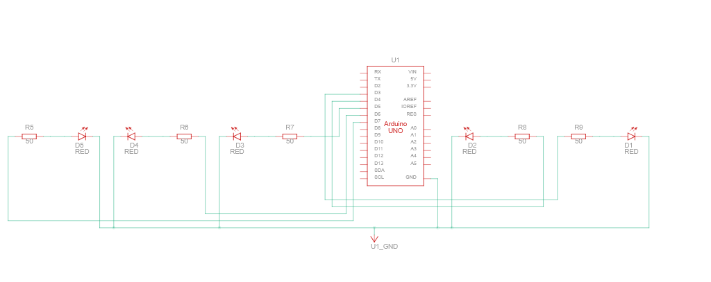

# Signals and Systems

> ** Remove the instructions in block quotes before you submit **

> Design, build, program, and test a signaling system that communicates useful information without a screen or speaker. The red, yellow, and green LEDs 
> automatically cycle through your planned states; no push button is needed. Complete this README as you work. Keep your planning, testing evidence, and 
> link to your video demo here.

## 1. System purpose

- **Problem and real-world context:** TODO
- **Intended user:** TODO
- **What information should your signals communicate?** TODO
- **How does the user interpret and use that information?** TODO

## 2. State table and pattern plan

> Use the launch activity's approach: interpret a pattern, identify its states, and explain its meaning. Plan at least three meaningful message states. A 
> message may use several rows, such as a blinking pattern.

> Record a new row whenever any LED changes. Use ON/OFF and durations in milliseconds (1,000 ms = 1 second). Add or remove rows as needed. The last row 
> returns to the first automatically.

***N.B.*** The binary representation field describes the state of colored LEDs*. All state changes occur in 100ms time.
> *a 1 in a given bit means on, 0 means off. The leftmost bit is the white LED, the next bit is the blue LED, followed in the same fashion by the green, yellow, and red LEDs.

| # | Binary representation | State name |
| --- | --- | --- |
| 1 | 00000 | ZERO |
| 2 | 10000 | ONE |
| 3 | 01000 | TWO |
| 4 | 11000 | THREE |
| 5 | 00100 | FOUR |
| 6 | 10100 | FIVE |
| 7 | 01100 | SIX |
| 8 | 11100 | SEVEN |
| 9 | 00010 | EIGHT |
| 10 | 10010 | NINE |
| 11 | 01010 | TEN |
| 12 | 11010 | ELEVEN |
| 13 | 00110 | TWELVE |
| 14 | 10110 | THIRTEEN |
| 15 | 01110 | FOURTEEN |
| 16 | 11110 | FIFTEEN |
| 17 | 00001 | SIXTEEN |
| 18 | 10001 | SEVENTEEN |
| 19 | 01001 | EIGHTEEN |
| 20 | 11001 | NINETEEN |
| 21 | 00101 | TWENTY |
| 22 | 10101 | TWENTY-ONE |
| 23 | 01101 | TWENTY-TWO |
| 24 | 11101 | TWENTY-THREE |
| 25 | 00011 | TWENTY-FOUR |
| 26 | 10011 | TWENTY-FIVE |
| 27 | 01011 | TWENTY-SIX |
| 28 | 11011 | TWENTY-SEVEN |
| 29 | 00111 | TWENTY-EIGHT |
| 30 | 10111 | TWENTY-NINE |
| 31 | 01111 | THIRTY |
| 32 | 11111 | THIRTY-ONE |

**Sequence:** 1 → 2 → 3 → ... → 32 → repeat  

## 3. Circuit design

### Ohm's law calculations

> Use `R = (V_output - V_LED) / I` to estimate the resistance for each LED. Use volts, amperes, and ohms; convert milliamperes to amperes. 
> . Choose a suitable available resistor and check the resulting current using `I = (V_output - V_LED) / R`.

| LED | Arduino output voltage (V) | LED voltage drop (V) | Calculated resistor voltage (V) | Target current (A) | Calculated resistance (Ω) | Chosen resistance (Ω) | Estimated actual current (A) |
| --- | --- | --- | --- | --- | --- | --- | --- |
| White LED | 5.0 | TODO | TODO | TODO | TODO | TODO | TODO |
| Blue LED | 5.0 | TODO | TODO | TODO | TODO | TODO | TODO |
| Green LED | 5.0 | TODO | TODO | TODO | TODO | TODO | TODO |
| Yellow LED | 5.0 | TODO | TODO | TODO | TODO | TODO | TODO |
| Red LED | 5.0 | TODO | TODO | TODO | TODO | TODO | TODO |

## 4. Testing and revision
> Test your system with two people outside our class. Show each person the complete sequence before explaining its intended meaning. Ask:
> What do you think this system is communicating? Describe what each light pattern means to you.
> Were any patterns confusing or difficult to tell apart? Explain which ones and why.
> What would make the signals easier to understand? Consider the colors, combinations, blinking, or timing.

**Person 1:** TODO

**Person 2:** TODO

**Did their interpretations match your intended meaning? Explain:** TODO

**Revisions made to the system based on feedback**
> Describe at least one revisions you made based on the feedback you received and TEST it again.

**Revision and reason**: TODO

**Result after testing the revision:** TODO

## 5. Video Demonstration
> Replace the placeholder below with a link to your video. Demonstrate the complete repeating sequence and explain what each signal communicates. Make sure 
> your instructor can access the video.

[Video demonstration](https://youtube.com/)
